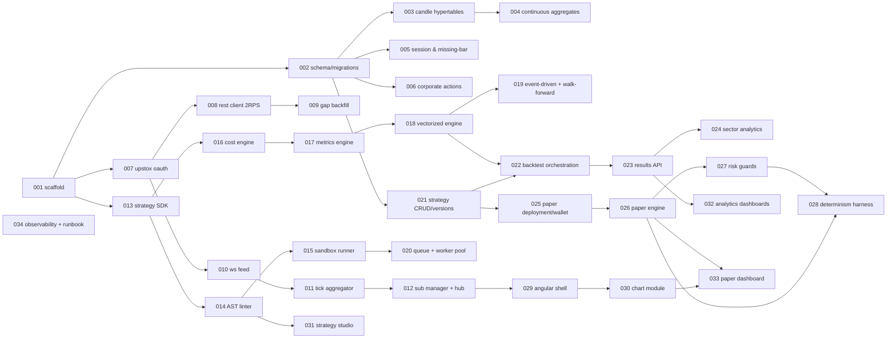

# Issue Breakdown — Algorithmic Trading Platform

Source of truth for product scope: [`algorithmic-trading-platform.md`](../../algorithmic-trading-platform.md).

This directory decomposes the specification into **34 small, independently shippable issues**. Each issue is
1–3 days of work, owns a narrow slice of architecture, and ships with a **copy-paste AI prompt** so an agent
(or a human) can implement it without re-reading the whole specification.

---

## 1. How to use this breakdown

1. Pick an issue whose dependencies are `Done` (see the graph in §4).
2. Read the issue file — every file has: **Goal → Scope → Small architecture → Contracts → Tasks →
   Acceptance criteria → Test plan → AI prompt**.
3. Run the issue with an AI agent: start it on a branch named `issue/SS-0NN-<slug>`, paste the
   **AI prompt** block, and attach the two files it lists as context.
4. A reviewer merges only when every **Acceptance criterion** is demonstrated (tests, a curl transcript,
   or a screenshot).

One branch, one issue. Never let an agent implement two issues in one branch — the value of this
breakdown is small, reviewable, revertible diffs.

---

## 2. Issue conventions

| Field | Rule |
| --- | --- |
| ID | `SS-NNN`, stable forever, referenced by other issues. |
| Size | ≤ 3 days. If bigger, split and add a `blocks` note. |
| Dependency | Only on issues that produce an **interface** (schema, proto, endpoint, type). |
| Definition of done | Code + tests + docs + migration (if any) + one demo command. |
| Out of scope | Always explicit — this is what keeps the issue small. |
| AI prompt | Self-contained: context, files, constraints, done-criteria. Never "see spec above". |

Each issue declares its **contract surface** (the thing other issues code against: a SQL table, a Go
interface, a gRPC method, an HTTP endpoint, or a WS message). Contracts are frozen once the issue merges;
changing one requires a follow-up issue that updates every consumer.

---

## 3. Target repository layout

```text
.
├── algorithmic-trading-platform.md   # product spec (frozen)
├── readme.md
├── docs/
│   ├── issues/                       # this breakdown
│   └── adr/                          # decided trade-offs (one file per decision)
├── api/                              # Go backend
│   ├── cmd/api/                      # HTTP + WS gateway
│   ├── cmd/backfiller/               # 2 RPS REST sync worker
│   ├── cmd/streamer/                 # Upstox WS -> ticks -> DB
│   ├── cmd/paperd/                   # deterministic paper-trading daemon
│   └── internal/
│       ├── config/  httpapi/  store/  upstox/  marketdata/
│       ├── ratelimit/  backfill/  paper/  risk/  analytics/  queue/
│       └── proto/                    # generated gRPC/Protobuf
├── engine/                           # Python strategy engine
│   ├── sdk/                          # BaseStrategy contract (user-facing)
│   ├── sandbox/  backtest/  costs/  metrics/  worker/
│   └── tests/
├── web/                              # Angular SPA
├── db/migrations/                    # golang-migrate SQL files
├── contracts/openapi.yaml            # HTTP contract, client generated from it
└── deploy/docker-compose.yml         # postgres+timescale, redis, engine, api
```

---

## 4. Dependency graph



**Critical path:** 001 → 002 → 003 → 007 → 008 → 009 → 013 → 018 → 021 → 022 → 025 → 026 → 028.
Everything else can run in parallel once its dependencies land.

---

## 5. Milestones and issues

### Milestone 0 — Foundations
| ID | Title | Depends on |
| --- | --- | --- |
| [SS-001](SS-001-monorepo-scaffold.md) | Monorepo scaffold, docker-compose, CI, config/logging/health | — |
| [SS-002](SS-002-metadata-schema.md) | Migration tool + metadata schema (sectors, stocks, calendar) + seeds | 001 |
| [SS-005](SS-005-session-and-missing-bars.md) | Market session filter & missing-bar policy | 002 |

### Milestone 1 — Data layer & Upstox ingestion
| ID | Title | Depends on |
| --- | --- | --- |
| [SS-003](SS-003-candle-hypertables.md) | Candle schema, TimescaleDB hypertables (1s/1m), upsert + range query repo | 002 |
| [SS-004](SS-004-continuous-aggregates.md) | Continuous aggregates 5m → 1Y + retention/compression policies | 003 |
| [SS-006](SS-006-corporate-actions.md) | Corporate actions & split/dividend adjustment pipeline | 002 |
| [SS-007](SS-007-upstox-oauth.md) | Upstox OAuth2 daily token lifecycle service | 001 |
| [SS-008](SS-008-upstox-rest-2rps.md) | Upstox historical REST client + 2 RPS token bucket + priority queue | 007 |
| [SS-009](SS-009-gap-backfill.md) | Gap detection & smart backfill worker | 005, 008 |
| [SS-010](SS-010-upstox-ws-feed.md) | Upstox Market Feed V3 Protobuf WebSocket client | 007 |
| [SS-011](SS-011-tick-aggregator.md) | Tick → 1s/1m aggregator, ring buffer, batched COPY writer | 003, 010 |
| [SS-012](SS-012-subscriptions-and-hub.md) | Subscription manager (active-view) + internal market-stream WS hub | 011 |

### Milestone 2 — Python strategy engine
| ID | Title | Depends on |
| --- | --- | --- |
| [SS-013](SS-013-strategy-sdk.md) | Strategy SDK contract, template, reference strategies | 001 |
| [SS-014](SS-014-ast-validator.md) | AST validator + look-ahead bias linter | 013 |
| [SS-015](SS-015-sandbox-runner.md) | Sandboxed ephemeral strategy runner (CPU/mem/net isolation) | 014 |
| [SS-016](SS-016-cost-engine.md) | Indian brokerage/STT/GST + slippage + volume-participation engine | 013 |
| [SS-017](SS-017-metrics-engine.md) | Quantitative metrics engine (Sharpe/Sortino/Calmar/PF/expectancy/drawdown) | 016 |
| [SS-018](SS-018-vectorized-backtest.md) | Vectorized single-stock backtest engine | 017 |
| [SS-019](SS-019-event-driven-walkforward.md) | Point-in-time event-driven engine + IS/OOS walk-forward harness | 018 |
| [SS-020](SS-020-queue-and-workers.md) | Redis Streams + gRPC worker pool with progress streaming | 015 |

### Milestone 3 — Orchestration & analytics (Go)
| ID | Title | Depends on |
| --- | --- | --- |
| [SS-021](SS-021-strategy-versions-api.md) | Strategy CRUD + immutable versioning API | 002, 014 |
| [SS-022](SS-022-backtest-orchestration.md) | Backtest orchestration, fan-out, progress WS | 020, 021 |
| [SS-023](SS-023-results-api.md) | Backtest results persistence + query API | 022 |
| [SS-024](SS-024-sector-analytics.md) | Sector composite scoring, leaderboard, best-strategy-per-stock | 023 |

### Milestone 4 — Deterministic paper trading
| ID | Title | Depends on |
| --- | --- | --- |
| [SS-025](SS-025-paper-deployments.md) | Deployment lifecycle, virtual wallet, position-sizing rules | 021 |
| [SS-026](SS-026-paper-engine.md) | Deterministic paper-trading engine (bar close, order types, fills, ledger) | 016, 025 |
| [SS-027](SS-027-risk-guards.md) | Risk guards: SL/trailing SL, exposure caps, daily max-loss kill switch | 026 |
| [SS-028](SS-028-determinism-harness.md) | Determinism replay harness + paper PnL/win-rate API & WS | 026 |

### Milestone 5 — Angular frontend
| ID | Title | Depends on |
| --- | --- | --- |
| [SS-029](SS-029-angular-shell.md) | SPA shell, routing, generated API client, resilient WS service | 003 |
| [SS-030](SS-030-chart-module.md) | Unified historical + live chart, overlays, buy/sell markers | 012, 029 |
| [SS-031](SS-031-strategy-studio.md) | Monaco Strategy Studio with SDK autocomplete + validation UX | 014, 021, 029 |
| [SS-032](SS-032-analytics-dashboards.md) | Backtest runner/progress, sector heatmap, stock-strategy matrix | 024, 029 |
| [SS-033](SS-033-paper-dashboard.md) | Paper-trading blotter, equity curve, live win rate, kill switch | 028, 030 |

### Milestone 6 — Hardening & release
| ID | Title | Depends on |
| --- | --- | --- |
| [SS-034](SS-034-observability-runbook.md) | Observability, load tests, seed/demo dataset, runbook | all |

---

## 6. Publishing these as GitHub issues (optional)

Each file maps 1:1 to a GitHub issue (title = first heading, body = the whole file, one `phase:*` label).
Nothing is published automatically:

```bash
./scripts/create-issues.sh --dry-run   # preview titles + labels
./scripts/create-issues.sh --yes       # create them (skips titles that already exist)
```

If you'd rather not create 34 issues up front, publish a milestone at a time with
`--milestone-filter "Milestone | 1"`.

---

## 7. Parallelisation plan

* **Sprint 1 (3 devs):** SS-001, SS-002 (serial foundation), then SS-006 ∥ SS-007 ∥ SS-013.
* **Sprint 2:** SS-003 → SS-004 ∥ SS-008 → SS-009 ∥ SS-010 → SS-011 ∥ SS-014 → SS-015 ∥ SS-016 → SS-017.
* **Sprint 3:** SS-018 → SS-019 ∥ SS-012 ∥ SS-020 ∥ SS-021 → SS-025.
* **Sprint 4:** SS-022 → SS-023 → SS-024 ∥ SS-026 → SS-027 ∥ SS-029 → SS-030.
* **Sprint 5:** SS-028, SS-031, SS-032, SS-033, SS-034.

Never parallelise two issues that touch the same table or the same Go package in the same sprint.
